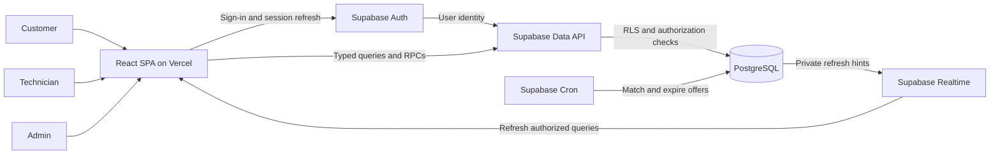
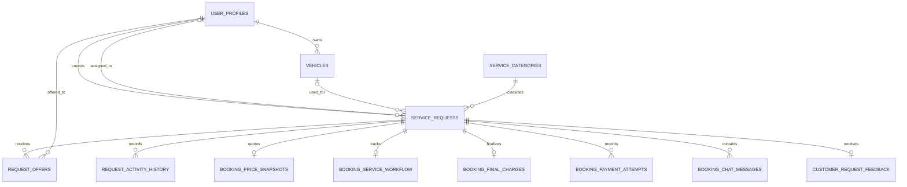

# NexRoad architecture and database

## Request lifecycle

A customer submits a quote and request. PostgreSQL recalculates the quote, rejects stale values and persists the accepted breakdown. Matching ranks eligible technicians by approach distance. Acceptance serializes on the request and technician, with unique indexes enforcing one accepted offer per request and one active request per technician. A technician records travel, arrival and a service report. The customer confirms completion and records simulated payment. Chat is restricted to the customer and assigned technician.

## Relationships

| Area | Data and access |
| --- | --- |
| Identity | Auth creates `user_profiles` and can initialize a pending `technician_applications` row. Admin approval controls technician access. Account suspension metadata is private. |
| Availability | Technician services, availability and latest coordinates determine matching eligibility. Assigned customer location reads require a current authorized booking and a valid shared fix. |
| Bookings | `service_requests` relates customers, categories, optional vehicles and assigned technicians. Status updates drive activity history and private Realtime refresh. |
| Quotes and payments | Quote snapshots and final charges preserve the accepted INR amount. Each payment attempt has an idempotency ID, and only one successful attempt is allowed per booking. |
| Chat | Messages store a booking and sender. The private read cursor tracks the last message seen by each participant. Admin monitoring excludes private chat bodies. |
| Administration | The private schema stores settings, service and fuel defaults, complaints, suspensions and admin audit history. Role-checked RPCs provide the client interface. |

See the versioned files in [supabase/migrations](../supabase/migrations) and client types in [database.types.ts](../src/lib/database.types.ts) for exact columns and function signatures.
